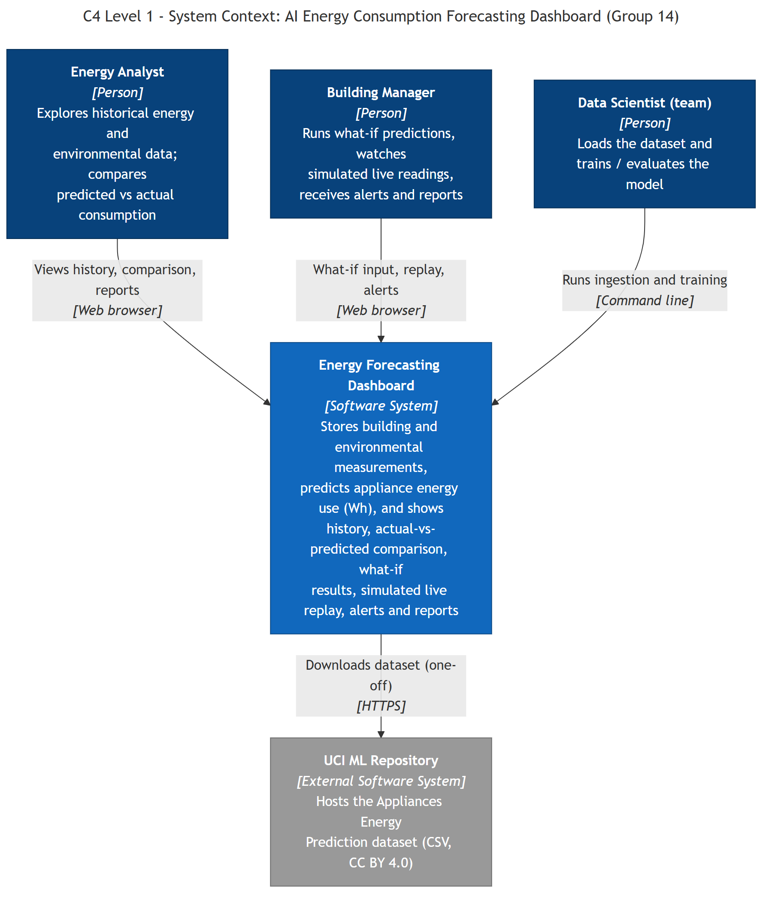
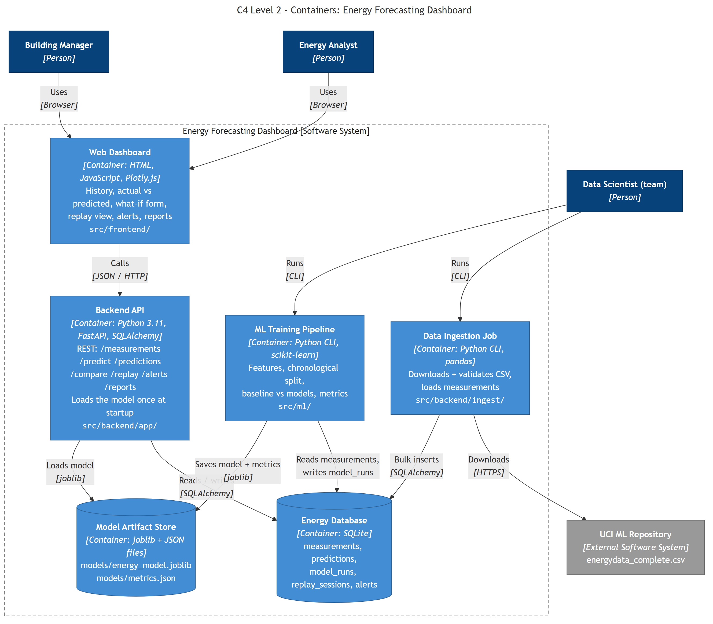

# Architecture

> Group 14 · AI Energy Consumption Forecasting Dashboard · Version: **v0.1.0-design**

This page is the entry point to the architecture. Each diagram has its own page under [`docs/architecture/`](architecture/), its editable Mermaid source under [`uml/`](../uml/), and a rendered PNG under [`uml/rendered/`](../uml/rendered/).

## Diagram index

| Diagram | Page | Editable source | Status |
|---|---|---|---|
| C4 Level 1: System Context | [c4_context.md](architecture/c4_context.md) | `uml/c4/c4_context.mmd` | v0.1.0-design |
| C4 Level 2: Containers | [c4_container.md](architecture/c4_container.md) | `uml/c4/c4_container.mmd` | v0.1.0-design |
| Sequence diagrams SD-01…SD-05 (container level) | [sequence_diagrams.md](architecture/sequence_diagrams.md) | `uml/sequence/*.mmd` | v0.1.0-design |
| ERD / data model | [data_model.md](architecture/data_model.md) | `uml/data/erd.mmd` | v0.1.0-design |
| Use case diagram + descriptions | *planned* | `uml/usecase/` | next docs PR |
| Component view (backend modules) | *planned* | `uml/c4/c4_component.mmd` | v0.3.0-design |
| Class diagram | *planned* | `uml/class/` | v0.3.0-design |
| Activity diagram (comparison/report) | *planned* | | v0.4.0-design |
| State diagram (replay session) | *planned* | | v0.5.0-design |
| Deployment view | *planned* | | v0.6.0-design |

## System context

## Containers

## Architectural style and key decisions

| ID | Decision | Rationale |
|---|---|---|
| AD-01 | Layered backend: `api/` (routers) → `services/` (logic) → `models.py` (ORM) | Each layer is testable in isolation (unit → component → integration) |
| AD-02 | Offline training pipeline separate from the online API | Retraining does not touch API code; the API only loads an artifact |
| AD-03 | SQLite + SQLAlchemy | Zero-install, single file, ERD-friendly; can be swapped for PostgreSQL by changing the URL |
| AD-04 | Static HTML/JS + Plotly served by FastAPI | One process to run; the UI is not the grading focus |
| AD-05 | Replay by HTTP polling, not WebSockets | Simpler to test and explain; one viewer |
| AD-06 | Two model modes: what-if (no lags) and next-step (with lags) | Data analysis showed persistence is a strong baseline ([dataset_analysis.md §7](dataset/dataset_analysis.md)) |

## Diagram maintenance rules

1. Edit the `.mmd` source **in place**. Never create `_v2` copies; Git history keeps every old version, and tags mark the reviewed ones.
2. Re-render with `npm run diagrams` (overwrites the PNGs in `uml/rendered/`) and commit **source and PNG together**.
3. If agent-generated code changes a container, endpoint, table or flow, update the diagram **in the same PR** before the increment is tagged.
