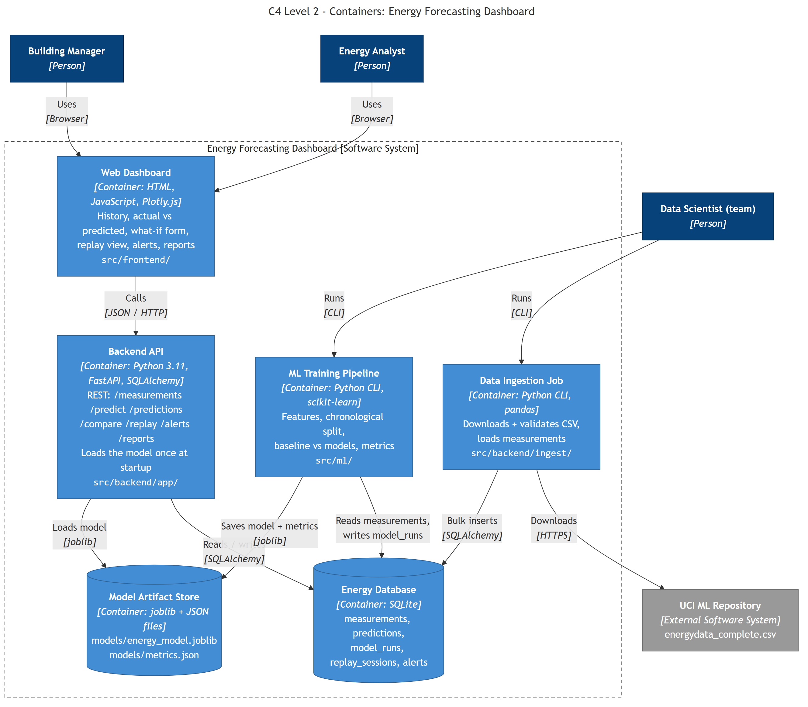

# C4 Level 2: Container Diagram

> Source: [`uml/c4/c4_container.mmd`](../../uml/c4/c4_container.mmd) · Rendered: [`uml/rendered/c4_container.png`](../../uml/rendered/c4_container.png) · Version: v0.1.0-design

## Containers

| Container | Technology | Responsibility | Code location | Requirements |
|---|---|---|---|---|
| Web Dashboard | HTML, JavaScript, Plotly.js (static files served by the API) | History, comparison, what-if, replay, alerts and report pages | `src/frontend/` | FR-03, FR-04, FR-09, FR-11, FR-12, FR-16 |
| Backend API | Python 3.11, FastAPI, SQLAlchemy, Pydantic | REST endpoints, validation, prediction serving, replay, alerts, reports | `src/backend/app/` | FR-02, FR-07–FR-10, FR-12–FR-16 |
| Data Ingestion Job | Python CLI, pandas | Download, validate and load the CSV into the database | `src/backend/ingest/` | FR-01 |
| ML Training Pipeline | Python CLI, pandas, scikit-learn | Features, chronological split, baselines and models, metrics, artifact | `src/ml/` | FR-05, FR-06 |
| Energy Database | SQLite file `data/energy.db` | Persistent store; schema in the [ERD](data_model.md) | `src/backend/app/models.py` | FR-01, FR-08, FR-15 |
| Model Artifact Store | joblib + JSON files in `models/` | Versioned trained model + metrics, loaded by the API | `src/ml/model_store.py` | FR-06, FR-07 |

## API contract (planned endpoints)

| Method | Path | Purpose | Increment |
|---|---|---|---|
| GET | `/api/health` | Liveness and model-loaded flag | v0.1.0 |
| GET | `/api/measurements?start&end&fields` | Historical readings for a date range | v0.1.0 |
| GET | `/api/measurements/summary?start&end` | Min/mean/max per variable | v0.1.0 |
| POST | `/api/predict` | What-if prediction from conditions | v0.3.0 |
| GET | `/api/predictions?source&limit` | Stored prediction history | v0.3.0 |
| GET | `/api/compare?start&end` | Actual vs predicted series + MAE/RMSE/R² | v0.4.0 |
| POST / GET / PATCH | `/api/replay`, `/api/replay/{id}/next`, `/api/replay/{id}` | Simulated live replay session | v0.5.0 |
| GET | `/api/alerts` | Alert log | v0.6.0 |
| GET | `/api/reports/summary?start&end&format=json\|csv` | Integrated report and export | v0.6.0 |

## Why these containers

- **Training is separate from serving.** Training is slow and offline, while serving must be fast. The API only *loads* the artifact, so the model can be retrained without changing API code.
- **SQLite** needs no server and is a single file. That is enough for one building and about 20k rows, and it still supports a proper ERD.
- **Static frontend served by FastAPI** means one process to run for demos (`uvicorn`). No Node build step is needed for the app.
