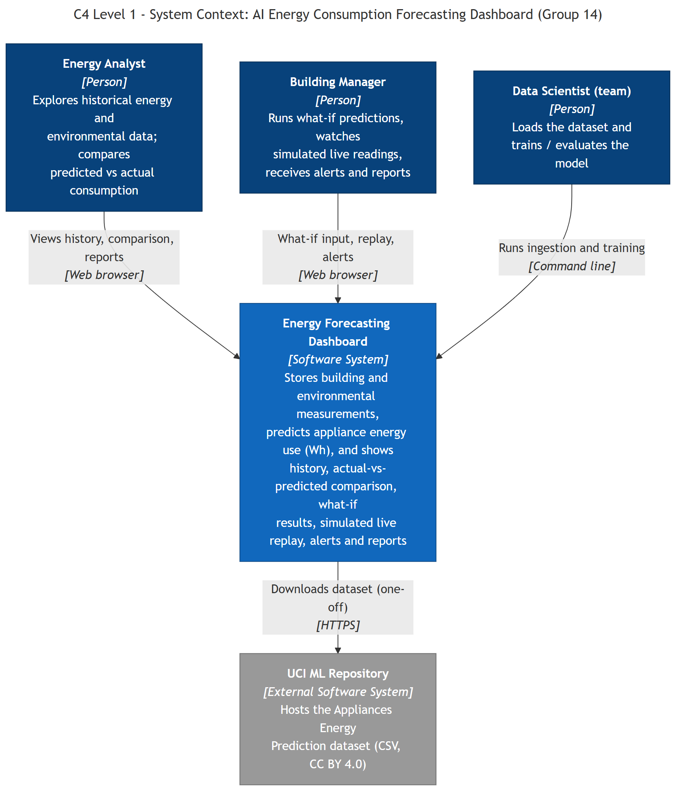

# C4 Level 1: System Context

> Source: [`uml/c4/c4_context.mmd`](../../uml/c4/c4_context.mmd) · Rendered: [`uml/rendered/c4_context.png`](../../uml/rendered/c4_context.png) · Version: v0.1.0-design

## Elements

| Element | Type | Responsibility |
|---|---|---|
| Energy Analyst | Person | Explores history (UC-03) and compares actual vs predicted energy (UC-04) |
| Building Manager | Person | Runs what-if predictions (UC-05), replay (UC-06), reads alerts and reports (UC-07) |
| Data Scientist (team) | Person | Runs ingestion (UC-01) and training (UC-02) from the command line |
| Energy Forecasting Dashboard | Our software system | Everything inside the boundary; detailed in the [container diagram](c4_container.md) |
| UCI ML Repository | External system | Supplies `energydata_complete.csv` once; there is no runtime dependency |

## Scope notes

- There is **no real building or sensor connection**. "Live" readings are replayed from the historical dataset (assumption A-01 in `docs/project_description.md`).
- There are no external email or SMS services. Alerts are shown on the dashboard and stored in the database.
- Users are demo identities only, and the system holds no personal data.
