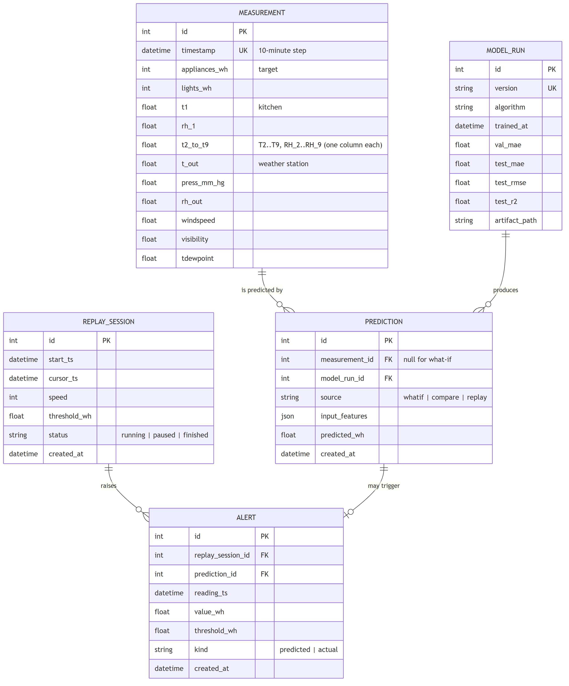

# Data Model (ERD)

> Source: [`uml/data/erd.mmd`](../../uml/data/erd.mmd) · Rendered: [`uml/rendered/erd.png`](../../uml/rendered/erd.png) · Implemented in `src/backend/app/models.py` · Version: v0.1.0-design

| Table | Rows (expected) | Notes |
|---|---|---|
| `measurements` | 19,735 | One row per 10-min reading; `timestamp` unique; 26 feature columns (all dataset columns except `rv1`, `rv2`). The diagram abbreviates T2–T9 / RH_2–RH_9 into one line, but each is a real column. |
| `model_runs` | a few | One per training run; holds validation and test metrics and the artifact path |
| `predictions` | grows | `source` ∈ {whatif, compare, replay}; `measurement_id` is null for what-if inputs |
| `replay_sessions` | few | State: running → paused ↔ running → finished |
| `alerts` | grows | Raised when predicted or actual energy exceeds the session threshold |
