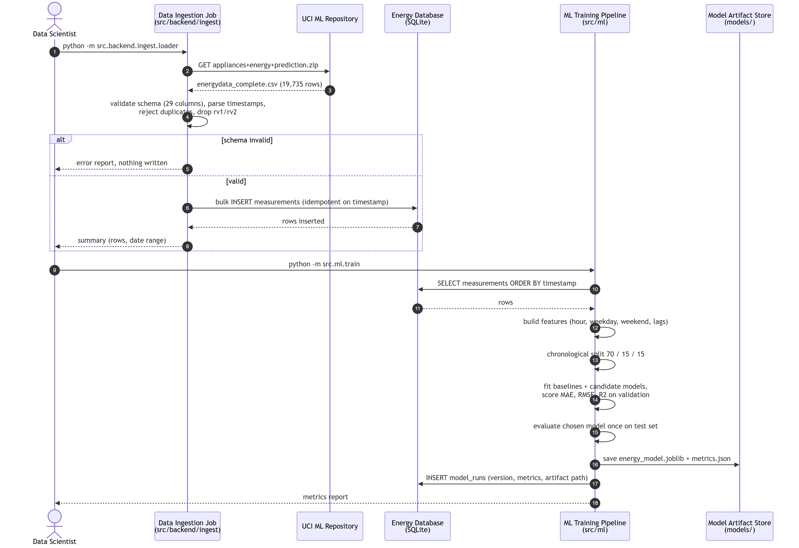
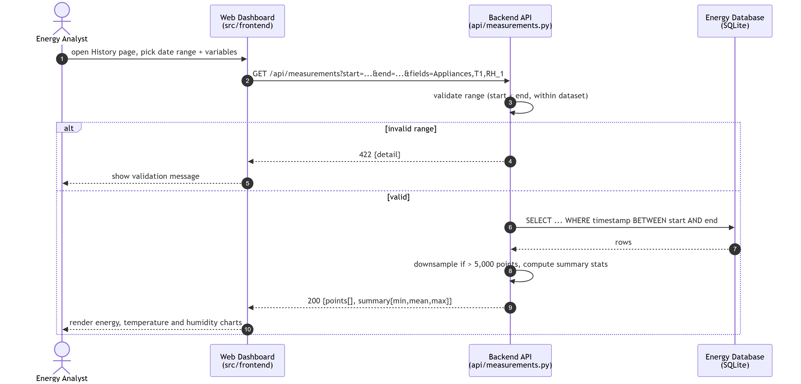
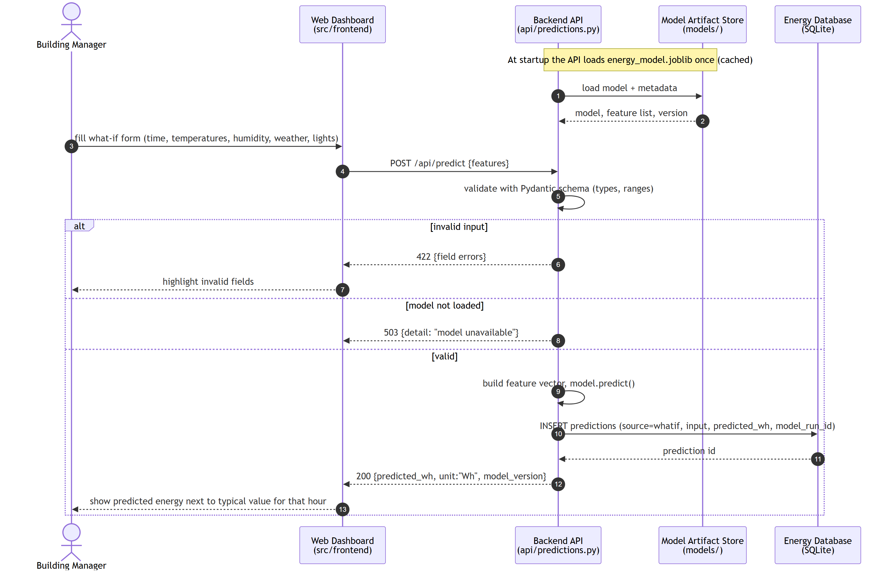
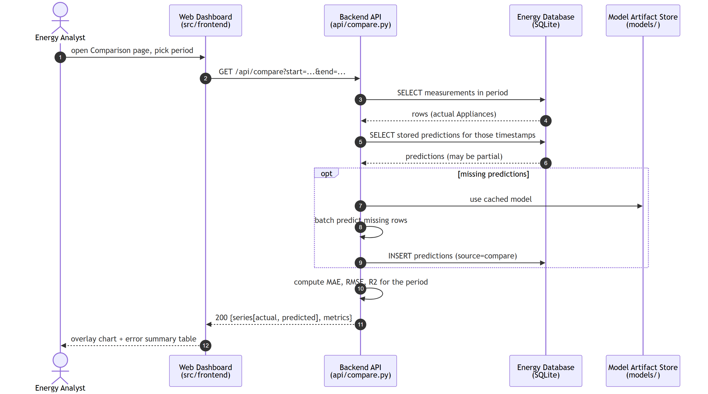
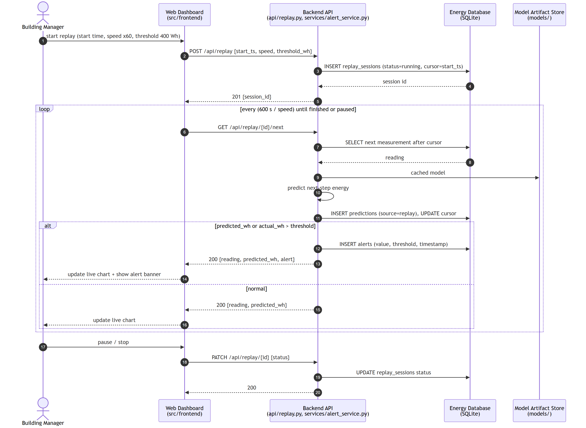

# Sequence Diagrams (container level)

> Version: v0.1.0-design. Each participant is a **C4 container** from the [container diagram](c4_container.md), labelled with the code module that implements it, so every arrow can be traced to code during the oral exam.
> Sources are in [`uml/sequence/`](../../uml/sequence/) and PNGs are in [`uml/rendered/`](../../uml/rendered/).

| ID | Scenario | Use case | Requirements | Source |
|---|---|---|---|---|
| SD-01 | Ingest dataset and train model | UC-01, UC-02 | FR-01, FR-05, FR-06 | [`seq_ingest_train.mmd`](../../uml/sequence/seq_ingest_train.mmd) |
| SD-02 | View historical measurements | UC-03 | FR-02, FR-03, FR-04 | [`seq_view_history.mmd`](../../uml/sequence/seq_view_history.mmd) |
| SD-03 | What-if prediction | UC-05 | FR-07, FR-08, FR-11 | [`seq_predict_whatif.mmd`](../../uml/sequence/seq_predict_whatif.mmd) |
| SD-04 | Compare actual vs predicted | UC-04 | FR-09, FR-10 | [`seq_compare.mmd`](../../uml/sequence/seq_compare.mmd) |
| SD-05 | Simulated live replay with alerts | UC-06, UC-07 | FR-12–FR-15 | [`seq_replay_alerts.mmd`](../../uml/sequence/seq_replay_alerts.mmd) |

## SD-01 Ingest dataset and train model

Ingestion is idempotent: re-running it does not duplicate rows, because `timestamp` is unique. Training never shuffles the data, and the test set is used exactly once.

## SD-02 View historical measurements

Large ranges are downsampled server-side (more than 5,000 points), so the browser stays responsive (NFR-01).

## SD-03 What-if prediction

The model is loaded **once at API startup**, not per request. Error paths: invalid input returns 422, and a missing model file returns 503 (NFR-03).

## SD-04 Compare actual vs predicted

Predictions already stored are reused. Only missing rows are predicted, and those results are cached in the database.

## SD-05 Simulated live replay with alerts

The dashboard polls `/next` at an interval of `600 s / speed`. Polling was chosen over WebSockets because it is simpler to test (integration tests can call `/next` directly), and it is enough for one viewer.
