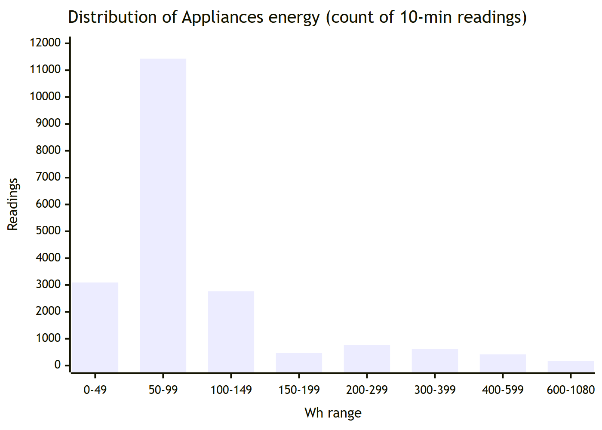
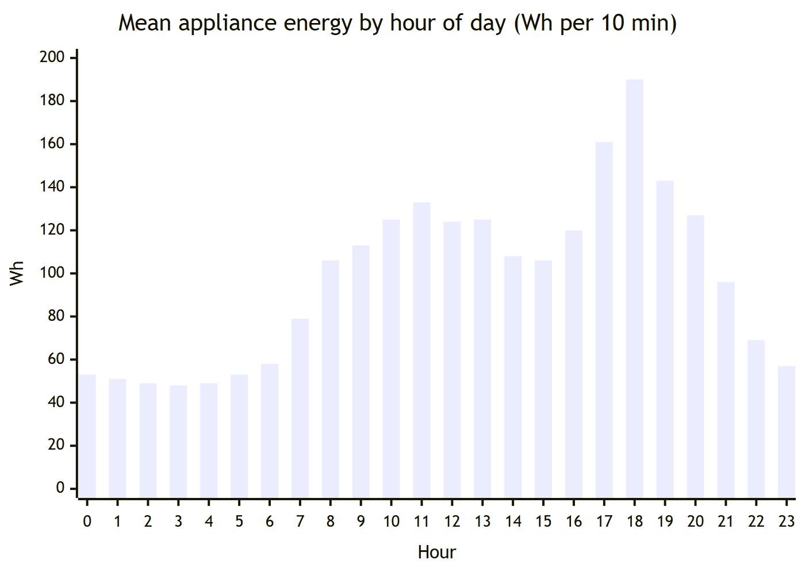

# Dataset Analysis: UCI Appliances Energy Prediction

> Version: v0.1.0-design · Owner: Member B (ML) with Member A (data) · Analysis run: 2026-11-11 on the full downloaded CSV

## 1. Source and licence

| Item | Value |
|---|---|
| Name | Appliances Energy Prediction (UCI dataset id 374) |
| URL | <https://archive.ics.uci.edu/dataset/374/appliances+energy+prediction> |
| File | `energydata_complete.csv` inside the downloaded zip (11.98 MB) |
| Licence | Creative Commons Attribution 4.0 (CC BY 4.0): use allowed with attribution |
| Citation | L. M. Candanedo, V. Feldheim, D. Deramaix, "Data driven prediction models of energy use of appliances in a low-energy house", *Energy and Buildings*, 140 (2017) 81–97 |
| How we obtain it | `python data/download_data.py` (not committed in full; see `data/README.md`) |
| Committed sample | `data/sample/energydata_sample.csv`: first 3 days (432 rows) for tests and demos |

## 2. Shape and quality (verified)

| Check | Result |
|---|---|
| Rows | **19,735** |
| Columns | **29** (1 timestamp, 1 target, 27 features) |
| Period | 2016-01-11 17:00 → 2016-05-27 18:00 (138 days, ~4.5 months) |
| Sampling | Exactly **10 minutes** between every pair of rows (no gaps) |
| Missing values | **0** in every column |
| Duplicate timestamps | **0** |
| `rv1` vs `rv2` | Identical columns (correlation 1.000), random noise by design → **dropped** |

Because the data is complete and perfectly regular, the ingestion job only needs **schema validation**, not imputation. That keeps FR-01 simple and testable.

## 3. Column dictionary

| Column(s) | Meaning | Unit | Range in data |
|---|---|---|---|
| `date` | Timestamp of the 10-min interval | `YYYY-MM-DD HH:MM:SS` | 2016-01-11 … 2016-05-27 |
| **`Appliances`** | **Target**: energy used by appliances in the 10-min interval | Wh | 10 – 1080 |
| `lights` | Energy used by light fixtures | Wh | 0 – 70 (steps of 10) |
| `T1`, `RH_1` | Kitchen temperature / humidity | °C / % | 16.8–26.3 / 27–63 |
| `T2`, `RH_2` | Living room | °C / % | 16.1–29.9 / 20–56 |
| `T3`, `RH_3` | Laundry room | °C / % | 17.2–29.2 / 29–50 |
| `T4`, `RH_4` | Office room | °C / % | 15.1–26.2 / 28–51 |
| `T5`, `RH_5` | Bathroom | °C / % | 15.3–25.8 / 30–96 |
| `T6`, `RH_6` | **Outside** the building (north side) | °C / % | −6.1–28.3 / 1–99.9 |
| `T7`, `RH_7` | Ironing room | °C / % | 15.4–26.0 / 23–51 |
| `T8`, `RH_8` | Teenager room 2 | °C / % | 16.3–27.2 / 30–59 |
| `T9`, `RH_9` | Parents room | °C / % | 14.9–24.5 / 29–53 |
| `T_out`, `RH_out`, `Press_mm_hg`, `Windspeed`, `Visibility`, `Tdewpoint` | Weather station (Chièvres airport) | °C, %, mmHg, m/s, km, °C | see `uml/charts` stats |
| `rv1`, `rv2` | Random variables (noise, for testing feature selection) | – | 0 – 50 |

## 4. The target: `Appliances`

| Statistic | Wh |
|---|---|
| Mean | 97.7 |
| Median | 60 |
| 75th percentile | 100 |
| 95th percentile | 330 |
| 99th percentile | 570 |
| Max | 1080 |
| Std. deviation | 102.5 |

**Findings**

- Strongly **right-skewed**: 58% of readings are 50–99 Wh, but 9.7% exceed 200 Wh and 1.5% exceed 500 Wh. Most of the error will come from these spikes.
- Consequence for the design: report **MAE and RMSE together** (RMSE punishes spikes), consider a log-transform of the target during training, and choose an alert threshold from the tail (the default **400 Wh** sits near the 97th percentile).

## 5. Time patterns

- Clear **daily cycle**: lowest at night (~48 Wh at 03:00), morning rise from 07:00, evening peak at **18:00 (~190 Wh)**.
- Weekday effect is weaker: Monday (111.5 Wh) and Fri/Sat (~105 Wh) are higher than Tue–Thu (~88 Wh).
- No strong monthly trend (monthly means 94–101 Wh), so a chronological split does not hit a big seasonal shift in the target, although temperatures rise from winter into spring.
- **Autocorrelation** of the target: lag-1 (10 min) = 0.75, lag-2 = 0.53, lag-6 (1 h) = 0.32, lag-144 (1 day) = 0.22.

→ Time features (hour, weekday, weekend) and **lag features** carry most of the signal.

## 6. Feature relevance (Pearson correlation with `Appliances`)

| Strongest | r | | Weakest | r |
|---|---|---|---|---|
| `lights` | +0.197 | | `T9` | +0.010 |
| `RH_out` | −0.152 | | `RH_5` | +0.007 |
| `T2` | +0.120 | | `Visibility` | 0.000 |
| `T6` | +0.118 | | `rv1`/`rv2` | −0.011 |
| `T_out` | +0.099 | | | |

No single environmental variable has a strong *linear* relationship with energy use (|r| < 0.2). Expect linear regression to perform poorly, and tree ensembles (random forest, gradient boosting) to do better by capturing non-linear and interaction effects.

## 7. Baselines we must beat (measured on the planned test split)

Planned chronological split (see `docs/ml_pipeline.md`): train = first 70% (to 2016-04-16 15:20), validation = next 15% (to 2016-05-07 04:40), test = last 15%.

| Baseline on the test set | MAE (Wh) | RMSE (Wh) | R² |
|---|---|---|---|
| Predict training mean | 52.8 | 90.9 | 0.00 |
| **Persistence: predict the previous reading (lag-1)** | **26.7** | **66.8** | **0.46** |

**Key design implication.** Persistence alone already reaches R² ≈ 0.46. A model that uses only room and weather conditions (no lags) will probably *not* beat it. So the system needs **two prediction modes**:

1. **What-if / conditions model** (FR-11): input = conditions + time features only, because a user typing a scenario has no "previous reading". Compared against the mean baseline.
2. **Next-step forecast model** (FR-13, replay and comparison): adds lag features (`Appliances` at t−1, t−2, t−3, 1-hour rolling mean). Must beat persistence.

## 8. Decisions recorded from this analysis

| ID | Decision | Reason |
|---|---|---|
| D-01 | Drop `rv1`, `rv2` | Pure noise, identical columns |
| D-02 | No imputation step; ingestion rejects malformed files instead | 0 missing, 0 duplicates, perfect 10-min grid |
| D-03 | Chronological 70/15/15 split, never shuffled | Time series; shuffling leaks future values via autocorrelation |
| D-04 | Metrics MAE, RMSE, R² against **both** baselines | Skewed target; persistence is a strong baseline |
| D-05 | Two model modes (what-if, next-step) | What-if inputs cannot contain lags |
| D-06 | Default alert threshold 400 Wh (configurable) | ~97th percentile of the target |
| D-07 | Commit only a 432-row sample | Instructor rule: no large datasets in Git |
